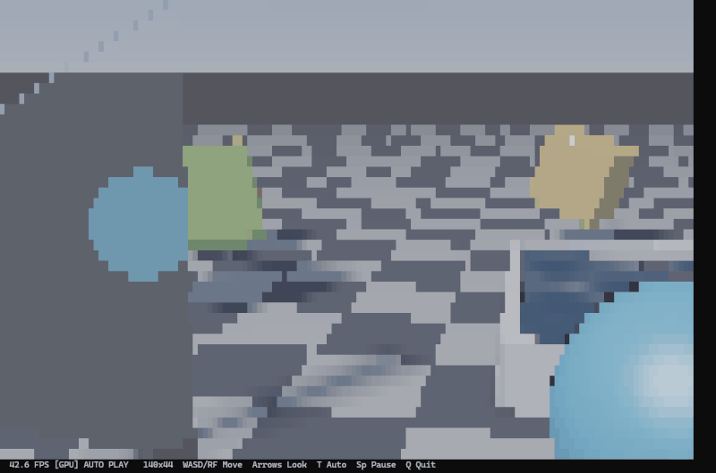

# 🚀 SDF 光线追踪在终端 (Terminal 3D SDF Raytracer)

[](LICENSE)

[](https://github.com/astral-sh/uv)


用纯 Python 和控制台 ANSI 字符方块（`█`），在终端里硬核手搓的 3D 光线追踪渲染器。
**无需任何图形库（如 Pygame/OpenGL），直接用数学公式和显卡算力点亮你的黑框框！**

 

---

## ✨ 核心特性 (Features)

- **SDF 光线步进 (Raymarching)**：抛弃传统多边形网格，纯靠纯数学公式（有符号距离场）绘制球体、立方体、四面体。
- **GPU / CPU 双擎渲染**：
  - 默认使用 **OpenCL (GPU)** 硬件加速，在核显上也能轻松跑到 30~60+ FPS。
  - 自动检测，失败时无缝回退到 **Numpy (CPU)** 纯软件渲染。
- **高级材质与物理**：
  - 🪞 **玻璃镜面**：支持菲涅尔效应、真实环境反射与棋盘格倒影。
  - 🌊 **动态水景池**：基于解析几何的动态波浪法线、折射与水面高光。
  - 🏀 **随波逐流**：浮球会随着波浪的高低物理起伏，并在水面绕圈。
- **底层终端工程**：绝对坐标定位（防闪烁）、备用缓冲区（防滚屏）、硬件级多键无冲读取（零延迟）。

---

## 📦 快速开始 (Quick Start)

推荐使用 [uv](https://github.com/astral-sh/uv) 工具，无需配置任何环境即可直接运行。

### 🚀 方式一：一键极速运行（推荐，无需克隆）
如果你已经安装了 `uv`，直接在你的终端（PowerShell / CMD）中输入以下命令，`uvx` 会在后台自动拉取代码、安装依赖并瞬间启动 3D 渲染器：

```bash
uvx --from git+https://github.com/My-ABC/terminal-3d-sdf.git sdf-3d --device GPU
```

*(如果你的显卡不支持 OpenCL，或者想看纯 CPU 算力，请将末尾的 `GPU` 改为 `CPU`)*

### 💻 方式二：克隆并本地运行（适合开发者）
如果你想查看源码、修改参数或参与开发，可以克隆仓库到本地运行：

```bash
# 1. 克隆仓库
git clone https://github.com/My-ABC/terminal-3d-sdf.git
cd terminal-3d-sdf

# 2. 同步依赖
uv sync

# 3. 运行
uv run sdf-3d --device GPU
```

---

## 🎮 操作说明 (Controls)

- `W / A / S / D`：前后左右移动摄像机
- `R / F`：摄像机上浮 / 下沉
- `↑ / ↓ / ← / →`：抬头 / 低头 / 左转 / 右转
- `T`：切换“自动巡航” / “手动飞行”模式
- `空格 (Space)`：暂停 / 继续动画
- `Q` 或 `Esc`：安全退出

---

## 🧠 技术原理解析 (Under the Hood)

这个项目没有使用任何三角形网格。所有的物体（甚至是水面和波浪）都是通过计算 **SDF (Signed Distance Fields)** 步进生成的。

每个终端字符 `█` 都对应屏幕上的一个像素，CPU/GPU 计算出该像素的 RGB 颜色后，通过 ANSI 转义序列 `\x1b[38;2;r;g;b;m` 瞬间输出到控制台。渲染核心使用 C99 语法编写在 `render.cl` 中，通过 `pyopencl` 编译并在 GPU 上并行执行。

---

## 📄 开源协议 (License)

[MIT License](LICENSE) © My-ABC